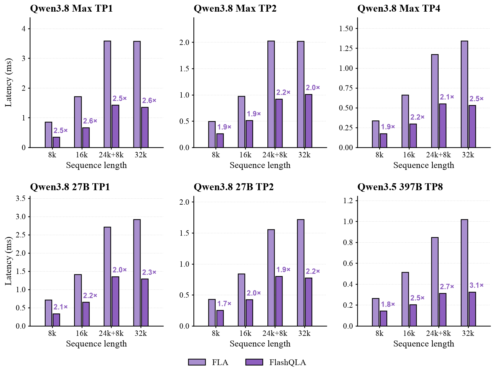
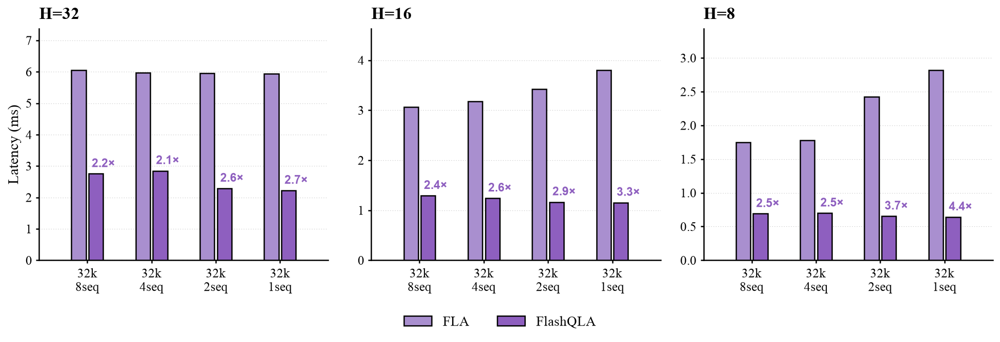
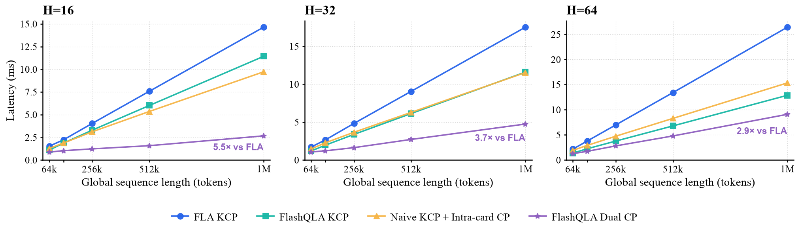
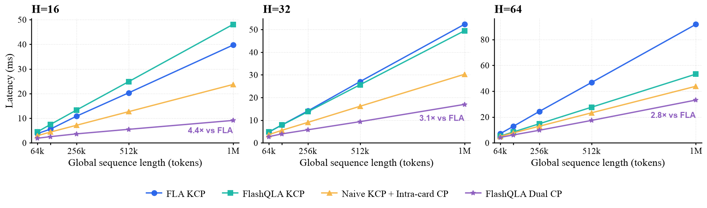

<p align="center">
    
</p>

<p align="center">|&nbsp&nbsp 📜 <a href="https://qwen.ai/blog?id=flashqla">Blog</a>&nbsp&nbsp |&nbsp&nbsp 📄 <a href="https://arxiv.org/abs/2611.32039">arXiv</a>&nbsp&nbsp |</p>

## News

- [2026-11] 🎉 Release FlashQLA v0.1.4 — adds TF32x3/FP32 correction on the CP path, dual-CP support on SM120, and ZigZag support.
- [2026-09] 🎉 Release FlashQLA v0.1.3 — adds dual-CP (inter/intra two-level context parallelism), a better auto-CP partitioning strategy, and the SM120 backward path.
- [2026-07] 🚀 Release FlashQLA v0.1.2 — adds forward pass for SM120 (Blackwell, thanks @minatoyukinaa) and now serves as a backend for [flash-linear-attention](https://github.com/fla-org/flash-linear-attention)'s GDN, providing plug-and-play acceleration through the standard FLA API.
- [2026-06] ⚡ Release FlashQLA v0.1.1 — adds intra-card sequence parallelism for the backward pass and SM100 support. Also upgrades tilelang to v0.1.9 and aligned entry function signatures to the latest `flash-linear-attention` interface.

## Introduction

FlashQLA is a high-performance linear attention kernel library built on [TileLang](https://github.com/tile-ai/tilelang). FlashQLA applies **reasonable operator fusion and performance optimization** to the forward and backward passes of GDN Chunked Prefill, achieving **1.7-3.1× forward speedup and up to 4.4× backward speedup** over the FLA Triton kernel on a single NVIDIA Hopper or Blackwell GPU. On eight GPUs with context lengths up to 1M tokens, Dual CP reaches **up to 4.8× forward speedup and 4.4× combined forward/backward speedup** over FLA KCP. The efficiency gains are particularly pronounced in pretraining scenarios and edge-side agentic inference.

Key features:

1. **Gate-driven automatic intra-card context parallelism**. By exploiting the exponential decay property of the GDN gate, FlashQLA automatically enables intra-card CP under TP, long-sequence, and small-head-count settings, improving GPU SM utilization.

2. **Dual CP for multi-GPU sequence parallelism**. Extends context parallelism beyond a single GPU with a two-level inter-card/intra-card layout, and shares summary computation between the two levels to reduce boundary-state preprocessing overhead.

3. **Hardware-friendly algebraic reformulation**. We reformulate the forward and backward flows of GDN Chunked Prefill to a certain extent, effectively reducing Tensor Core, CUDA Core, and SFU overhead without sacrificing numerical precision.

4. **TileLang fused warp-specialized kernels**. Rather than following the step-by-step decomposition into independent kernels, nor fusing the entire computation flow into a single kernel, we take CP and backward requirements into account, use TileLang to build several key fused kernels, and manually implement warpgroup specialization to overlap data movement, Tensor Core computation, and CUDA Core computation.

## Installation

Requirements:

- SM90, SM100, SM103, SM120 or SM121
- CUDA 12.8 or above
- PyTorch 2.8 or above

To install:

```bash
pip install flash-qla
```

Alternatively you can build from source:

```bash
git clone https://github.com/QwenLM/FlashQLA.git
cd FlashQLA
pip install -v .
```

## Usage

### High-level API

```python
import torch
import torch.distributed as dist
from flash_qla import chunk_gated_delta_rule
from flash_qla.ops.gated_delta_rule.chunk import CHUNK_SIZE, build_cp_context

# Optional: build an explicit CP context.
# Omit `cp_context` and intra-card CP is chosen automatically (`auto_cp=True`).
cp_context = build_cp_context(
    cu_seqlens,                      # global varlen offsets
    enable_inter=True,               # split the sequence across ranks
    enable_intra=True,               # split each rank's local sequence further
    group=dist.group.WORLD,
    num_v_heads=v.shape[2],
    chunk_size=CHUNK_SIZE,
)

o, final_state = chunk_gated_delta_rule(
    q=q,          # [B, T, H_q, K]
    k=k,          # [B, T, H_q, K]
    v=v,          # [B, T, H_v, V]
    g=g,          # [B, T, H_v]
    beta=beta,    # [B, T, H_v]
    scale=scale,
    initial_state=initial_state,   # optional, [B, H_v, K, V]
    output_final_state=True,
    cu_seqlens=cu_seqlens,         # optional, for variable-length sequences
    cp_context=cp_context,         # optional, explicit inter/intra-card CP layout
)
```

### Low-level API

For separate forward and backward calls:

```python
from flash_qla import chunk_gated_delta_rule_fwd, chunk_gated_delta_rule_bwd

# reuse the cp_context built above (optional)
# Forward
g, A, o, h, final_state, cp_cache = chunk_gated_delta_rule_fwd(
    q, k, v, g, beta, scale=scale, initial_state=h0, cu_seqlens=cu_seqlens,
    cp_context=cp_context,
)

# Backward
dq, dk, dv, db, dg, dh0 = chunk_gated_delta_rule_bwd(
    q, k, v, g, beta, A, do, dht=dht, scale=scale, initial_state=h0,
    cu_seqlens=cu_seqlens, cp_cache=cp_cache, cp_context=cp_context,
)
```

## Tests

```bash
python -m pytest tests/test_gdr_unit.py -v
```

## Profiling

```bash
# require flash linear attention for comparison
pip install flash_linear_attention==0.5.0

python profile/profile_gdr.py --set develop
python profile/profile_gdr.py --set develop --skip-bwd
```

## Benchmark

We benchmarked FlashQLA against the FLA Triton and FlashInfer baseline (FLA 0.5.0, Triton 3.5.1, FlashInfer 0.6.9, TileLang 0.1.8) on the head configurations used by the Qwen3.5 / Qwen3.6 family h_k,v \in {64, 48, 32, 24, 16, 8}, corresponding to TP1 through TP8.

### Single-GPU

<p align="center">
    
    <br/>
    <em>Forward speedup over FLA on H200.</em>
</p>
<p align="center">
    
    <br/>
    <em>Backward speedup over FLA on H200.</em>
</p>

On a single GPU, FlashQLA achieves 1.7-3.1× forward speedup and up to 4.4× backward speedup over FLA. The forward (FWD) benchmarks measure single-kernel latency for different models and TP settings under varying batch lengths, while the backward (BWD) benchmarks examine the relationship between total token count within a batch and latency during a single update step.

More detail in [benchmark_results_H200.txt](./benchmark/benchmark_results_H200.txt) and [benchmark_results_GB200.txt](./benchmark/benchmark_results_GB200.txt).

```bash
# require flash linear attention and flashinfer for comparison
pip install flash_linear_attention==0.5.0 flashinfer-python==0.6.13

python benchmark/bench_gated_delta_rule.py
```

### Multi-GPU Context Parallelism

<p align="center">
    
    <br/>
    <em>Dual CP forward speedup on H200x8 with up to 1M-token contexts.</em>
</p>
<p align="center">
    
    <br/>
    <em>Dual CP forward + backward speedup on H200x8 with up to 1M-token contexts.</em>
</p>

With Dual CP scaling to eight GPUs and context lengths up to 1M tokens, FlashQLA reaches up to 4.8× forward speedup and 4.4× combined forward/backward speedup over FLA KCP.

More detail in the CP benchmark results:

- H200×8: [benchmark_cp_results_H200x8.txt](./benchmark/benchmark_cp_results_H200x8.txt)
- GB200×4: [benchmark_cp_results_GB200x4.txt](./benchmark/benchmark_cp_results_GB200x4.txt)
- RTX 5090×2: [benchmark_cp_results_5090x2.txt](./benchmark/benchmark_cp_results_5090x2.txt)

```bash
# require flash linear attention for the KCP baseline
pip install flash_linear_attention==0.5.0

torchrun --nproc_per_node=8 benchmark/bench_gated_delta_rule_cp.py --mode infer
torchrun --nproc_per_node=8 benchmark/bench_gated_delta_rule_cp.py --mode train
```

## Acknowledge

FlashQLA is inspired by [Flash Linear Attention](https://github.com/fla-org/flash-linear-attention), [TileLang](https://github.com/tile-ai/tilelang) and [FlashInfer](https://github.com/flashinfer-ai/flashinfer/) projects.

## License

FlashQLA is released under the MIT License.

## Citation

```bibtex
@misc{flashqla2025,
    title={FlashQLA: Flash Qwen Linear Attention},
    author={Zhang, Chengruidong and Lin, Xi and Jiang, Huiqiang and Wang, Zekun and Li, Xiao and Cao, Yizhong and Zhuang, Bohan and Men, Rui and Zhang, Jianwei and Zheng, Bo and Lin, Junyang and Liu, Dayiheng and Zhou, Jingren},
    year={2026},
    publisher={GitHub},
    howpublished={\url{https://github.com/QwenLM/FlashQLA}},
}

@article{lin2026flashqla,
      title={FlashQLA: Efficient Context Parallelism for Gated DeltaNet}, 
      author={Lin, Xi and Zhang, Chengruidong and Jiang, Huiqiang and Li, Xiao and Wang, Zekun and Feng, Junda and Mao, Yunfei and Zhang, Siqi and Wang, Siyu and Yuan, Man and Men, Rui and Zheng, Bo and Liu, Dayiheng and Zhuang, Bohan and Zhang, Jianwei},
      journal={arXiv preprint arXiv:2611.32039},
      year={2026}
}
```
